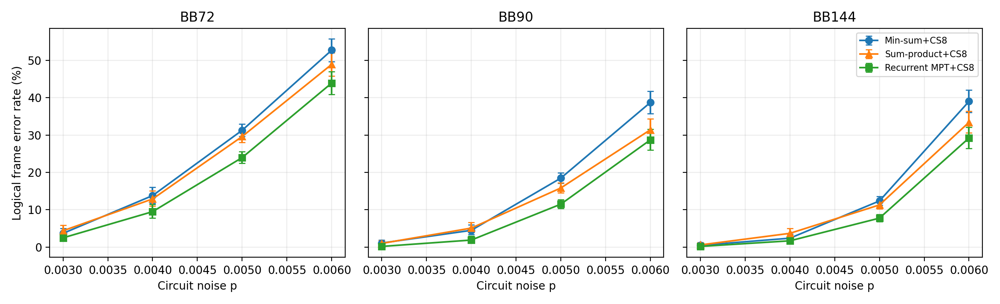

# 循环MPT与CS8融合的BB码量子纠错解码

面向12轮含噪测量，使用循环CrossMPT输出DEM故障软信息，再接CS8后处理。本仓库仅包含技术报告涉及的方法、模型和复现材料，不包含其他探索实验。

## 已有结果

下表为p=0.005、每码3000帧的逻辑帧错误率。各方法使用同批样本、相同输出H/故障先验、相同CS8及先验候选评分。

| 码 | Min-sum BP+CS8 | Sum-product BP+CS8 | 循环MPT+CS8 |
|---|---:|---:|---:|
| BB72 | 31.27% | 29.60% | **23.97%** |
| BB90 | 18.47% | 15.83% | **11.50%** |
| BB144 | 12.37% | 11.30% | **7.77%** |

相对sum-product基线，错误率降低约19.0%、27.4%、31.3%。四档噪声、置信区间和配对统计见[技术报告](report/technical_report.md)、[sum-product结果](results/sum_product/results.json)。



## 环境与准备

Python≥3.11。原实验环境版本见`configs/versions.json`，未保证其他版本/硬件逐bit一致。完整精度复现推荐CUDA GPU，推理使用BF16，稀疏聚合使用FP32；CPU可以运行，但数值细节可能不同。

```bash
python -m pip install -e .
python scripts/fetch_upstream.py
```

CrossMPT的两个运行时文件按固定提交、SHA256从原仓库获取，下载到被Git忽略的`third_party/`。本仓库不将上游源码重新授权或混入自己的代码。来源和权利说明见[THIRD_PARTY.md](THIRD_PARTY.md)。

请使用Git克隆后的源目录运行；`assets/`、`checkpoints/`等是源码仓库配套材料，不是已发布的独立PyPI数据包。

## 快速检查与推理评测

```bash
python tests/verify_release.py --device cuda
qec-mpt evaluate --code bb72 --noise 0.005 --limit 16 --device cuda --workers 2
```

完整复现全部18000个测试帧：

```bash
qec-mpt evaluate --code all --noise all --device cuda --workers 8 --output runs/report_replay
```

该命令重新运行神经网络、min-sum、sum-product及共享CS8，不直接读取已保存失败率。`summary.json`记录失败帧数，并在完整报告测试集上与原结果比较。单次前向也可直接调用：

```python
from qec_mpt.data import test_data
from qec_mpt.model import infer
a = test_data('bb72', 0.005)
z = infer('bb72', 0.005, a['detectors'][:64], device='cuda')
# z=log(P(error=1)/P(error=0)); canonical LLR=-z; hard decision=z>0
```

不使用报告测试样本、生成新的独立DEM测试：

```bash
qec-mpt evaluate --dataset fresh --shots 3000 --seed 20261116 --code bb72 --noise 0.005 --device cuda --output runs/fresh
```

## 训练

训练样本在线采样有效DEM，不使用报告测试标签。故障BCE按期望故障数归一化，辅助逻辑BCE权重0.2；两层、四头、d64、无门循环，跨时间共享参数。

从头训练示例：

```bash
qec-mpt train --code bb72 --samples 1000000 --lr 0.0003 --schedule cosine --output runs/train_bb72 --device cuda
```

从发布模型继续训练示例：

```bash
qec-mpt train --code bb72 --initialize checkpoints/bb72.pt --samples 900000 --lr 0.0001 --schedule step --output runs/continue_bb72 --device cuda
```

`best.pt`/`final.pt`按独立验证BCE选取，`last.pt`保存优化器和RNG，可使用相同命令恢复。这里提供整理后的训练入口；它复现数据分布、网络、损失及优化方式，不承诺重新训练得到报告的逐bit权重。报告权重有完整训练历史：BB72/90为10万初训+90万续训；BB144从历史普通模型另续训90万，不能称为三者等训练预算。三者均触及续训上限，未证明完全收敛。

## 后处理到底做什么

- 主结果：零中心OSD，按有符号LLR升序扫描，选取rank(H)个独立列作为主元，其余自由坐标初值0。
- CS8：基础候选、每个自由坐标的单次翻转、前8个自由坐标的两两翻转，每个候选补偿主元以满足校验。
- 候选按DEM先验评分；两种BP和MPT共享同一实现，不按测试点挑选评分。
- 排序不等于阈值截断，也不等于主元覆盖全部最低LLR坐标。`report/`中的高置信度诊断采用绝对LLR排序，是独立分析，不是主实验零中心排序本身。

## 评测范围

本实验是固定12轮、逻辑X记忆读出的一组可对易逻辑观测量评测，不是完整任意量子态纠错性能。E的坐标是合并DEM故障变量，不能当成数据比特。

神经网络接收两类检测事件，BP基线使用单类输出检测器图。结果比较完整配置，不能仅归因于神经网络替代BP。BP均为parallel、最多200迭代；sum-product输出存在无穷LLR，送CS8前按规则截为±10⁶，统计见结果JSON。未进行BP调度/参数全面优化，不声称超过所有传统解码器。

报告测试集没有参与梯度更新或检查点选择，但此前用于探索性诊断，不称为未接触盲测。训练种子、码长、输入信息范围及计算成本仍有局限；本仓库不声称速度优势或跨码共享权重泛化。

## 目录

```text
src/qec_mpt/       循环模型、数据/噪声、训练、CS8、评测入口
assets/           码矩阵、固定四档p的Stim电路及元数据
checkpoints/      三个最终检查点
data/report_test/ 报告测试集、故障真值和随机种子
results/          三方结果、逐帧逻辑预测/失败标签、统计
report/           技术报告及图表
provenance/       训练历史、检查点选择、来源和完整性记录
tests/            独立模型回放、故障映射与OSD一致性核对
```

仅支持已发布的三种码、四档p及12轮测量，不把固定电路套件宣传成任意噪声/码长生成器。重新构建其他电路应沿原代码来源实现并另行验证。

## 引用与贡献

方法借鉴[CrossMPT](https://arxiv.org/abs/2405.01033)与[AlphaQubit](https://www.nature.com/articles/s41586-024-08148-8)；BB电路来源为[Blue等公开实现](https://github.com/jblue1/ml_bb_decoding)及其[论文](https://quantum-journal.org/papers/q-2026-06-30-2149/)。BP+OSD参考[Roffe等](https://arxiv.org/abs/2005.07016)，仿真使用[Stim](https://quantum-journal.org/papers/q-2021-07-06-497/)。

本项目的工作是面向BB多轮测量实现循环CrossMPT故障输出与噪声条件化、融合CS8，并开展可复现的多码配对评测和可靠性分析；不主张发明CrossMPT、循环Transformer或OSD。
