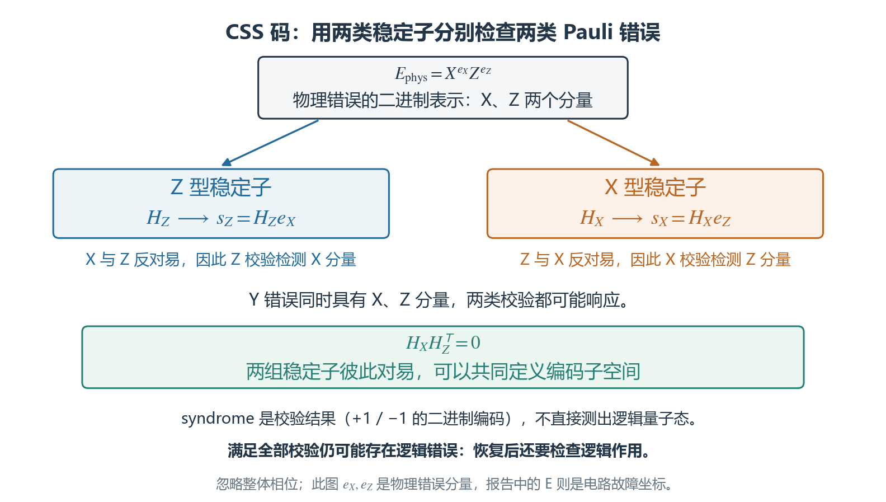
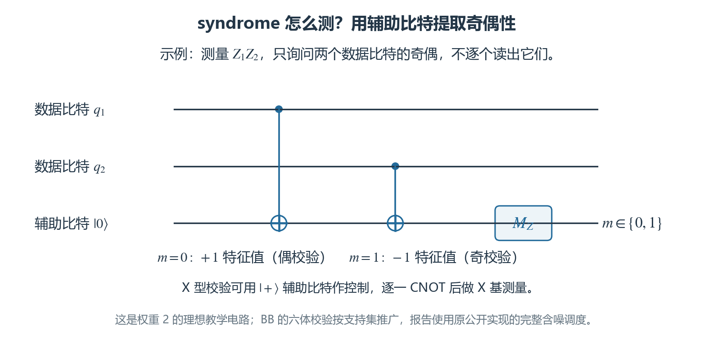
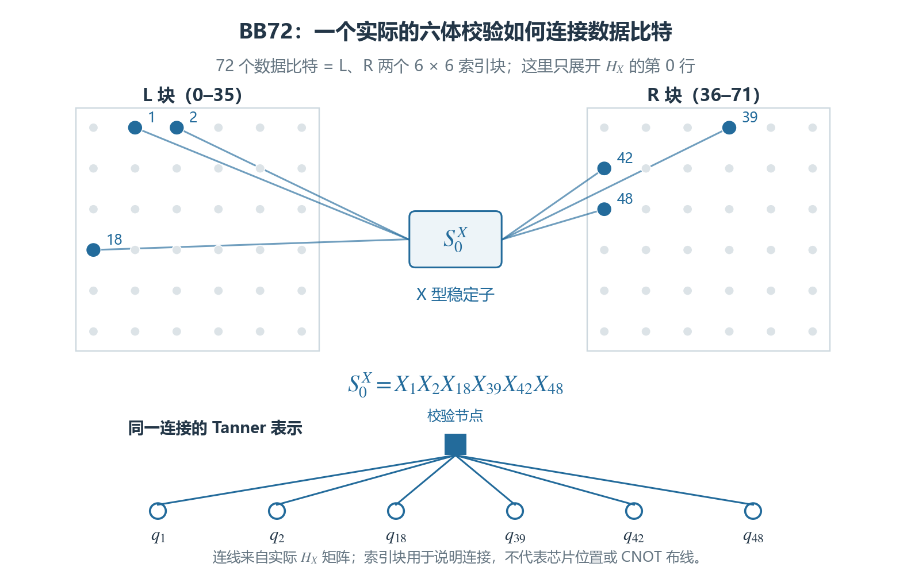
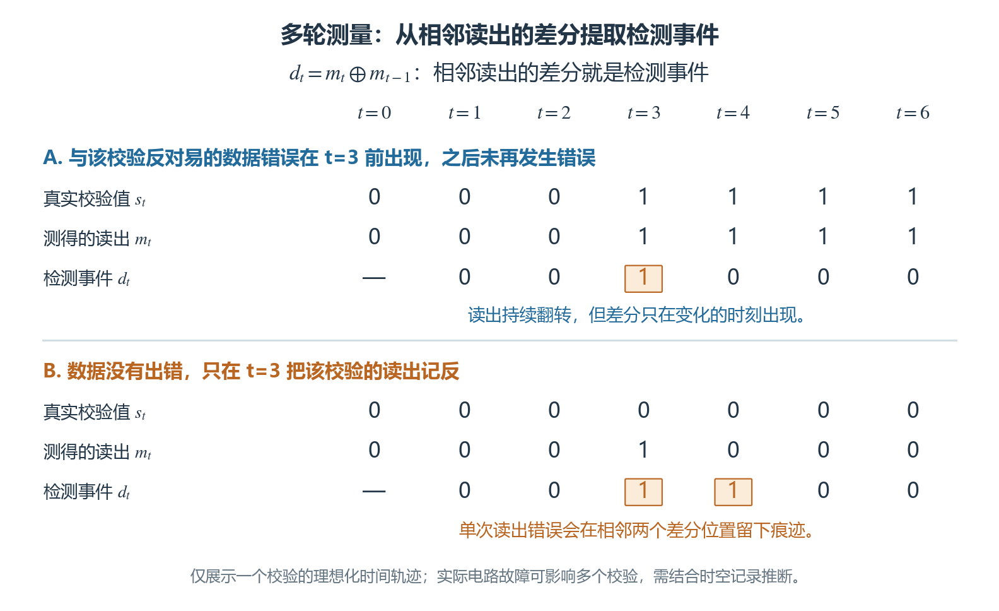
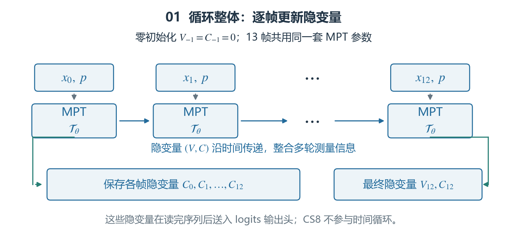
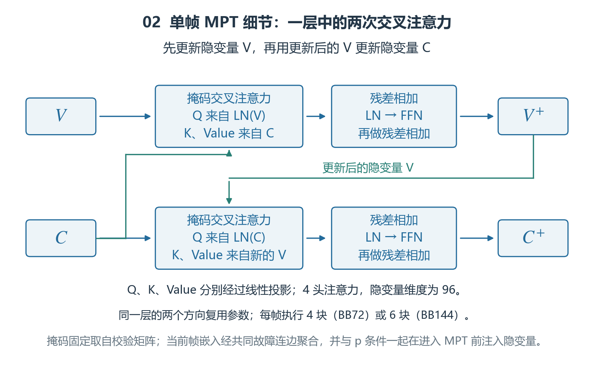
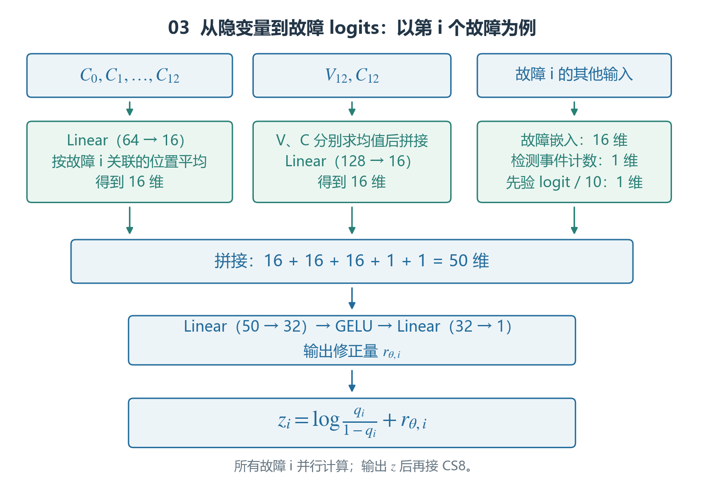

# 面向多轮含噪测量的循环交叉注意力与有序统计融合量子纠错解码

作者：钟路安｜西安交通大学数学与统计学院

## 摘要

本研究面向BB码的多轮含噪测量，构建循环交叉注意力与有序统计融合解码方案。模型利用共享参数的CrossMPT逐帧处理两类校验的检测事件，并结合噪声条件预测各电路故障的概率；随后通过CS8有序统计后处理生成满足校验约束的恢复。模型以在线生成的电路故障样本训练，采用二元交叉熵损失。

在三种BB码、12轮含噪测量和四档电路噪声下，共开展32000帧配对评测。噪声参数p=0.005时，BB72、BB90、BB144的逻辑帧错误率分别为24.18%、11.52%、8.33%，相较标准sum-product BP+CS8的28.34%、15.52%、11.65%，相对降低14.7%、25.8%、28.5%。软信息分析表明，在保留同等数量高置信度坐标时，模型在所分析的置信度范围内留下更少的硬判决错误，为代数后处理提供了更可靠的信息。

**关键词：**量子纠错；循环Transformer；CrossMPT；BB码；有序统计译码。

## 1 研究背景与目标

量子信息的存储和处理受到物理噪声影响，需要通过冗余编码与反复测量校验算子保护逻辑信息。测量过程本身也可能出错，因此解码器需要综合多轮记录，推断数据错误与测量错误的共同影响。BB码具有稀疏校验结构，是低开销量子纠错的重要研究对象。[Bravyi等，2024](https://www.nature.com/articles/s41586-024-07107-7)

BP通过稀疏图上的消息传递估计故障概率，OSD利用这些软信息安排代数求解与候选搜索，二者结合是量子LDPC码的代表性解码方法。[Roffe等，2020](https://arxiv.org/abs/2005.07016) 本研究关注如何利用神经网络整合多轮测量信息，生成适合后处理的故障概率，进一步降低逻辑错误率。

CrossMPT利用掩码交叉注意力实现变量节点与校验节点之间的信息交换；AlphaQubit展示了循环网络处理量子纠错测量历史的效果。本文结合这两类方法的结构思想，为BB码构建逐帧更新隐变量、并行预测故障概率的循环CrossMPT，并接入统一的CS8后处理流程。[CrossMPT](https://arxiv.org/abs/2405.01033)；[AlphaQubit](https://www.nature.com/articles/s41586-024-08148-8)

本文给出模型实现、训练方法及三种BB码上的配对实验，并分析故障置信度排序与后处理性能之间的联系。

## 2 问题定义与仿真表示

### 2.1 CSS码与校验测量的基本概念

稳定子码通过一组彼此对易的Pauli算子定义编码子空间。合法编码态具有规定的稳定子特征值；当错误与某个稳定子反对易时，该校验的特征值发生翻转。解码器利用这些校验结果推断错误的影响。

CSS码把稳定子分为只含X的校验与只含Z的校验。忽略整体相位，物理Pauli错误可写成X、Z两个二进制分量：Z型校验检测X分量，X型校验检测Z分量；Y错误同时包含这两个分量。两组校验矩阵满足\(H_XH_Z^{\mathsf T}=0\)，从而保证稳定子彼此对易。

以\(Z_1Z_2\)为例，可制备一个辅助比特，使两个数据比特分别控制对辅助比特的CNOT，再测量辅助比特。其结果给出\(Z_1Z_2\)的特征值，而不分别给出两个数据比特的取值。推广到更高权重稳定子时，需要与其支持集中的数据比特交互。本文的含噪仿真进一步包含完整门调度、辅助比特复位及各操作位置的噪声。

### 2.2 BB72的结构与Tanner图表示

BB码利用两个可交换的循环移位矩阵构造稀疏校验。本文BB72的索引参数为\(l=m=6\)，取\(A=x^3+y+y^2\)、\(B=y^3+x+x^2\)，其中x、y分别沿两个周期索引方向移位。校验矩阵为

\[
H_X=[A\;B],\qquad H_Z=[B^{\mathsf T}\;A^{\mathsf T}].
\]

由于A、B可交换，二元域上\(H_XH_Z^{\mathsf T}=AB+BA=0\)。72个数据比特按L、R两个6×6索引块展示。每一行校验矩阵对应一个稳定子；行中非零位置就是它作用的数据比特。在Tanner图中，这表现为一个校验节点连接相应变量节点。

下图直接从发布的BB72矩阵取\(H_X\)第0行，非零位置为1、2、18、39、42、48，因此该稳定子是六个对应X算子的乘积。图中的六条连接对应这一行校验矩阵的非零位置。网络掩码利用的正是这类校验连接结构。

### 2.3 多轮记忆实验

实验采用理想初态制备和初始校验、12轮含噪校验测量、理想末轮校验及最终数据读出。相邻轮测量结果的异或形成检测事件，得到13个时间帧。每个检测事件取值为0或1。

仿真基于Stim，并沿用Blue等公开代码的电路生成方法。噪声覆盖公开电路中规定的单比特及双比特去极化、制备和读出等故障位置，统一由参数p控制；p是电路噪声参数，不等同于每个故障变量的概率。BB72和BB144保留公开实现的测量调度与逻辑算子；BB90使用同一电路生成流程推广，并独立验证其CSS对易关系和逻辑算子关系。[Stim](https://quantum-journal.org/papers/q-2021-07-06-497/)；[Blue等论文](https://quantum-journal.org/papers/q-2026-06-30-2149/)；[公开代码](https://github.com/jblue1/ml_bb_decoding)

检测事件的时空分布包含区分不同故障的信息。若一个数据错误在某轮出现并持续存在，受影响校验的读出可能持续翻转，差分却只在变化时刻出现；若只有单次读出被记反，通常会在该单校验时间轨迹的相邻两个差分位置出现事件。下图展示这两种典型轨迹。电路故障可能同时影响多个校验，解码器据此联合利用时间与空间信息。

### 2.4 故障向量、校验约束与评测目标

在有效检测器错误模型（DEM）中，令E∈F₂ᴺ表示故障变量向量，H为检测事件矩阵，L为被追踪逻辑观测量的翻转映射，则

\[
s=HE,\qquad y=LE,
\]

其中运算均在二元域上进行。H的一列描述一个故障对所选检测事件的影响，L的对应列描述其对被追踪逻辑观测量的影响。具有相同检测事件和逻辑影响的有效故障合并为同一变量；这类独立DEM机制的合并概率按奇偶翻转概率计算。

解码器输出恢复向量\(\hat E\)，后处理要求

\[
H\hat E=s.
\]

本实验把所有被追踪逻辑观测量均恢复正确记为成功，即

\[
L\hat E=LE.
\]

不同故障向量可以产生相同的检测事件和逻辑影响，恢复成功由上述逻辑条件判定。本文采用逻辑X记忆读出，统计一次完整12轮记忆实验中，至少一个被追踪逻辑观测量恢复错误的概率，称为逻辑帧错误率。

| 配置 | 数据比特数n | 被追踪逻辑观测量数k | 合并故障变量数N | 输出H尺寸 | rank(H) | 模型参数量 |
|---|---:|---:|---:|---:|---:|---:|
| BB72 | 72 | 12 | 4392 | 468×4392 | 462 | 189089 |
| BB90 | 90 | 8 | 5490 | 585×5490 | 581 | 208961 |
| BB144 | 144 | 12 | 8784 | 936×8784 | 930 | 268577 |

表中n为物理数据比特数，N为合并后的电路故障变量数。

## 3 循环MPT与CS8融合解码方法

整体流程分为三个层次：循环部分逐帧读入测量特征并更新隐变量\(V,C\)；单帧MPT用两次有顺序的交叉注意力更新这两组隐变量；序列读完后，独立输出头把隐变量转换为全部故障的logits，再接CS8。下文依次介绍循环结构、单帧注意力模块和故障输出头。每种码分别训练模型，模型内部各时间帧共享参数。

### 3.1 测量输入与噪声条件

每个时间帧、每个校验节点使用四维特征：检测事件的累计异或值、当前检测事件、有效标记和末帧标记。当前固定长度电路中有效标记恒为1。模型同时接收两类校验的信息，输入张量形状为13×n×4。

此外，将噪声参数p变换为相对参考值的logit条件：

\[
c(p)=W_p\left[\operatorname{logit}(p)-\operatorname{logit}(0.003)\right].
\]

该条件分别加入隐变量\(V,C\)。当前帧测量特征的嵌入加入C。对于每个输出故障，模型还使用DEM计算得到的实际先验概率qᵢ。因而p与qᵢ承担不同功能：p提供整体电路噪声条件，qᵢ保留不同故障位置的非均匀先验。

### 3.2 共享参数的循环交叉注意力

模型维护两组隐变量\(V,C\)，维度均为\(n\times64\)。按时间顺序读入13帧，每帧运行两层、四头的掩码交叉注意力。注意力的连接范围由CSS校验矩阵构造的固定掩码控制。

每一层先以归一化V为查询来源、以C为键和值的来源更新V，经过残差与FFN后，再以归一化C为查询来源、以新的V为键和值的来源更新C。Q、K、Value分别经过线性投影。同一层的两个方向复用模块参数，两层之间则有各自参数；第1层后和第2层后均对两组隐变量做LayerNorm。

循环更新可概括为

\[
(V_t,C_t)=\mathcal T_\theta\left(
\frac{V_{t-1}+B_V+c_V(p)}{\sqrt2},
\frac{C_{t-1}+\phi(x_t)+B_C+c_C(p)}{\sqrt2}
\right),
\]

其中B为可学习的位置嵌入，φ为输入嵌入，\(\mathcal T_\theta\)在各时间帧共享参数。模型读完测量序列后，并行输出全部故障概率。交叉注意力核心沿用官方CrossMPT的残差与LayerNorm组织方式，并使用GELU前馈网络。

这种设计通过隐变量传递时间信息，并保留每帧C供故障输出头聚合整段测量历史。

### 3.3 故障概率输出与监督训练

对每个故障i，先把各帧隐变量C投影至16维，再按该故障关联的时空位置进行平均。另一方面，对最终隐变量V和C分别取位置均值，将两个64维向量拼接并投影至16维。二者再与16维故障身份嵌入、1维相关检测事件计数及1维缩放先验logit拼接，得到50维输入。输出头为50→32→1的前馈网络，其输出作为先验logit的修正量：

\[
z_i=\log\frac{q_i}{1-q_i}+r_{\theta,i},\qquad
\hat p_i=\sigma(z_i).
\]

相应的对数似然比（LLR）定义为

\[
\lambda_i=\log\frac{1-\hat p_i}{\hat p_i}=-z_i.
\]

硬判决为\(\hat e_i^{\rm hard}=\mathbf1[z_i>0]\)，可信度排序的诊断使用\(|\lambda_i|\)。绝对值较小表示预测概率接近1/2，判决的不确定性较高。

训练样本在线生成：根据有效DEM采样故障，计算对应的检测事件及合并故障标签，分别作为输入和监督目标。测试样本由Stim DEM采样器生成。

训练采用二元交叉熵损失，按批大小B和期望故障数归一化：

\[
\mathcal L=\frac{1}{B\,\mu(p)}\sum_{b=1}^{B}\sum_{i=1}^{N}
\operatorname{BCEWithLogits}(z_{b,i},E_{b,i}),\qquad \mu(p)=\sum_iq_i.
\]

### 3.4 共享的CS8后处理

本文主实验对BP与MPT使用完全相同的后处理实现，采用零中心构造：按zᵢ从大到小，即按有符号LLR λᵢ从小到大扫描列，选取线性无关的列作为待求主元。

设r=rank(H)，所选r列构成集合P，其余列为自由坐标。基础候选将自由坐标设为0，通过消元求出主元部分，使H\(\hat E\)=s。CS8进一步枚举每个自由坐标的单次翻转，以及排序最前8个自由坐标的两两翻转；每次翻转均通过主元补偿维持校验约束。候选数为

\[
1+(N-r)+\binom{\min(8,N-r)}{2}.
\]

主实验使用信道先验代价

\[
J_{\rm prior}(\hat E)=\sum_i\hat E_i\log\frac{1-q_i}{q_i}
\]

选择代价最小的候选作为恢复。全部方法使用相同的候选构造与评分规则，每帧完整执行候选搜索。

## 4 实验设置

三种BB码均采用两层、四头、隐变量维度64的循环MPT，各自从随机初始化开始训练。训练噪声p在0.003、0.004、0.005、0.006中等概率选取。训练样本由有效DEM在线生成，优化器为AdamW，批大小64，权重衰减10⁻⁴，梯度裁剪阈值1，指数移动平均系数0.99。

前10万样本使用从3×10⁻⁴降至3×10⁻⁵的余弦学习率，随后重置优化器，学习率从10⁻⁴起每20万样本减半，最低为10⁻⁵。BB72、BB90分别训练100万样本，BB144累计训练600万样本。每档噪声固定1024个独立验证样本，每10万训练样本评估一次，按四档平均归一化故障BCE选择EMA检查点。

测试集共32000帧：BB72、BB90各8000帧，其中p=0.005各5000帧，其余噪声点各1000帧；BB144共16000帧，其中p=0.005有10000帧，其余噪声点各2000帧。检查点确定后使用独立随机种子生成测试集，每个配置下的全部解码器共享相同样本。

BP基线包括min-sum和标准sum-product两种更新规则，均采用并行调度、最多200次迭代和非均匀DEM故障先验；min-sum的缩放参数设为0（所用LDPC实现的自适应缩放模式）。各方法接入第3.4节的统一CS8后处理。MPT的输入覆盖两类校验的测量历史，BP在所选单类检测器图上推断；二者共享输出故障变量、恢复约束与评测目标。

## 5 实验结果

### 5.1 逻辑帧错误率

下表比较循环MPT与两种BP基线接入相同CS8后的逻辑帧错误率。MS表示min-sum BP，SPA表示标准sum-product BP。

| 码 | p | 帧数 | MS+CS8 | SPA+CS8 | MPT+CS8 |
|---|---:|---:|---:|---:|---:|
| BB72 | 0.003 | 1000 | 4.70% | 4.80% | 3.40% |
| BB72 | 0.004 | 1000 | 12.70% | 12.90% | 11.20% |
| BB72 | 0.005 | 5000 | 30.60% | 28.34% | 24.18% |
| BB72 | 0.006 | 1000 | 55.20% | 51.40% | 46.80% |
| BB90 | 0.003 | 1000 | 1.30% | 1.30% | 0.20% |
| BB90 | 0.004 | 1000 | 5.10% | 4.40% | 2.50% |
| BB90 | 0.005 | 5000 | 17.28% | 15.52% | 11.52% |
| BB90 | 0.006 | 1000 | 38.70% | 32.80% | 29.10% |
| BB144 | 0.003 | 2000 | 0.35% | 0.35% | 0.15% |
| BB144 | 0.004 | 2000 | 2.55% | 2.15% | 1.20% |
| BB144 | 0.005 | 10000 | 12.29% | 11.65% | 8.33% |
| BB144 | 0.006 | 2000 | 37.90% | 32.40% | 29.15% |

### 5.2 相对性能改善

以p=0.005为例，相较标准sum-product BP+CS8，循环MPT+CS8的改善如下。成功率变化按同一测试帧上的失败差值计算，区间为配对均值差的近似95%置信区间，成功率变化及其区间均以百分点计。

| 码 | 成功率变化 | 配对95%区间 | 错误率相对降幅 |
|---|---:|---:|---:|
| BB72 | +4.16 | [+3.03,+5.29] | +14.7% |
| BB90 | +4.00 | [+2.97,+5.03] | +25.8% |
| BB144 | +3.32 | [+2.66,+3.98] | +28.5% |

三个码在这一噪声点的配对区间均高于0，支持本次测试中循环MPT+CS8相对标准BP+CS8的性能改善。BB72、BB90、BB144的逻辑错误率相对降幅分别为14.7%、25.8%、28.5%。

## 6 软信息分析与讨论

为分析模型提供的故障置信度，按各解码器的绝对LLR从小到大排序，取前C个位置作为不确定部分，统计其余高置信度位置的硬判决错误数。该分析用于观察预测错误是否集中在较低置信度位置，以及高置信度硬判决的可靠性。

在p=0.005、C=512时，得到以下平均错误数。每个码内，各方法保留的坐标数相同。

| 码 | MPT | Min-sum BP | Sum-product BP |
|---|---:|---:|---:|
| BB72 | 0.62 | 4.43 | 3.92 |
| BB90 | 1.05 | 5.91 | 5.33 |
| BB144 | 2.35 | 11.32 | 10.52 |

三个码在C=512时均表现出更可靠的高置信度硬判决。例如，BB144的平均错误数由标准BP的10.52降至MPT的2.35。这一现象与最终逻辑错误率的改善相呼应：网络将更多预测错误集中到低置信度位置，为代数恢复提供了更有利的软信息。图中也显示，可靠性差异随C变化，因而这一性质应结合具体置信度范围理解。

实验结果表明，循环MPT能够利用测量历史产生有利于CS8的故障概率。后续可进一步研究如何依据这种可靠性分布设计候选搜索，提高软信息的利用效率。当前实验覆盖三种BB码和固定12轮电路噪声，每个码使用一个训练种子；进一步验证可扩展至更多训练种子、测量轮数和噪声条件。

## 7 结论

本文构建了面向BB码多轮含噪测量的循环CrossMPT与CS8融合解码流程。模型逐帧整合两类校验的检测事件，结合噪声条件并行预测故障概率，再通过统一的有序统计后处理生成恢复。在三种BB码和四档噪声的配对实验中，该流程均取得低于所配置标准BP+CS8的逻辑帧错误率；p=0.005时，相对降幅为14.7%、25.8%、28.5%。

软信息诊断进一步显示，模型在所分析的高置信度范围内具有更少的硬判决错误。这为性能收益提供了实验线索，也为改进概率估计与代数后处理的衔接提供了研究方向。

## 参考文献与代码来源

1. [Bravyi et al. High-threshold and low-overhead fault-tolerant quantum memory. Nature, 2024.](https://www.nature.com/articles/s41586-024-07107-7)
2. [CrossMPT: Cross-attention Message-Passing Transformer for Error Correcting Codes. ICLR 2025.](https://arxiv.org/abs/2405.01033) [官方代码](https://github.com/iil-postech/crossmpt)
3. [Bausch et al. Learning high-accuracy error decoding for quantum processors. Nature, 2024.](https://www.nature.com/articles/s41586-024-08148-8)
4. [Roffe et al. Decoding Across the Quantum LDPC Code Landscape. Physical Review Research, 2020.](https://arxiv.org/abs/2005.07016)
5. [Gidney. Stim: a fast stabilizer circuit simulator. Quantum, 2021.](https://quantum-journal.org/papers/q-2021-07-06-497/)
6. [Blue et al. Machine Learning Decoding of Circuit-Level Noise for Bivariate Bicycle Codes. Quantum, 2026.](https://quantum-journal.org/papers/q-2026-06-30-2149/) [电路代码](https://github.com/jblue1/ml_bb_decoding)

## 实验材料索引

主结果与逐帧输出见../results/；训练历史和选择记录见../provenance/；最终模型见../checkpoints/；电路与码矩阵见../assets/。目录README提供训练、推理及复现实验命令。
