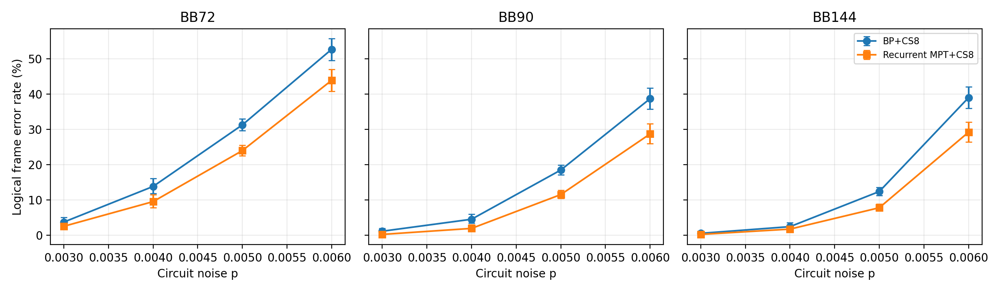
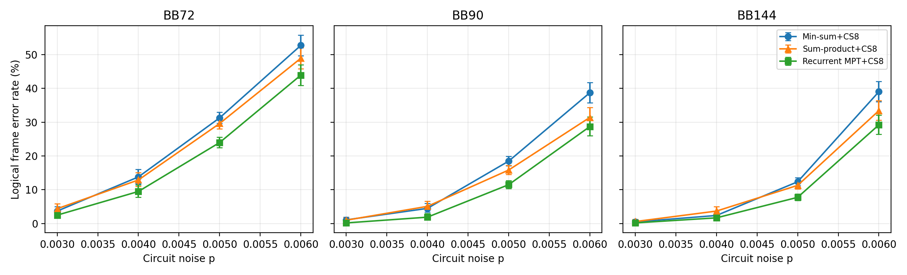
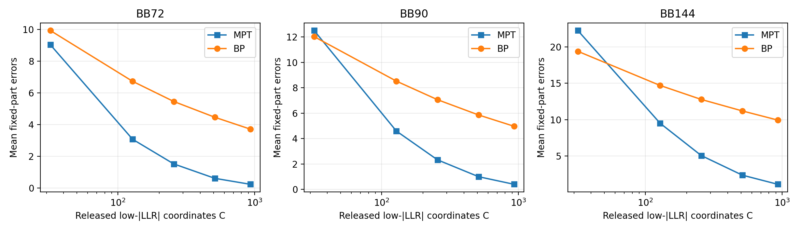

# 面向多轮含噪测量的循环交叉注意力与有序统计融合量子纠错解码

作者：钟路安｜西安交通大学数学与统计学院

**基线更新说明：**本文原主表中的BP指min-sum BP，现已补齐标准sum-product BP+CS8对照，见第5.3节。原“相对降低23.3%—37.7%”仅针对min-sum基线；针对sum-product基线，p=0.005时相对降低为19.0%、27.4%、31.3%。第6节可靠性分析仍比较MPT与min-sum，不能直接套用于sum-product。

## 摘要

量子纠错需要根据含噪测量记录推断错误的逻辑影响。传统置信传播结合有序统计译码（BP+OSD）能够兼顾概率推断与校验约束，但其软信息仍可能受到局部图结构及近似推断的影响。本文面向Bivariate Bicycle（BB）码的多轮电路噪声记忆实验，构建循环交叉注意力Transformer与OSD融合的解码方案。模型以两类校验的多轮检测事件及噪声条件为输入，利用共享参数的循环CrossMPT提取时空信息，预测检测器错误模型中各故障变量的概率，再通过CS8有序统计后处理获得满足校验约束的恢复结果。

在BB72、BB90和BB144的12轮含噪测量实验中，采用相同测试样本、输出校验矩阵、故障先验和CS8后处理实现进行比较，所构建方案在四档已测噪声下均取得低于BP+CS8的逻辑帧错误率。在噪声参数p=0.005时，三种码的逻辑错误率分别由31.27%、18.47%、12.37%降低至23.97%、11.50%、7.77%，相对降幅约为23.3%、37.7%、37.2%。逐坐标分析进一步表明，在释放一定数量的低置信度坐标后，MPT保留部分的硬判决错误显著少于BP。这为性能收益提供了一种有实验支持、但尚未完成因果隔离的解释，也提示了针对软信息特性的后处理优化方向。

**关键词：**AI for Science；量子纠错；BB码；循环Transformer；置信传播；有序统计译码。

## 1 研究背景与目标

量子信息的存储和处理受到物理噪声影响，需要通过冗余编码与反复测量校验算子来保护逻辑信息。由于测量过程本身也可能出错，单轮测量通常不足以区分数据错误与测量错误，解码器需要综合多轮记录推断恢复操作。BB码是低开销量子纠错的重要研究对象之一，其码结构和电路实现已有公开研究与工具支持。[Bravyi等，2024](https://www.nature.com/articles/s41586-024-07107-7)

BP利用稀疏图进行近似概率推断，OSD则利用软信息安排代数求解与候选搜索。二者结合是量子LDPC码解码中的代表性方法。[Roffe等，2020](https://arxiv.org/abs/2005.07016) 本项目关注的问题是：能否利用神经网络整合多轮测量信息，生成更有利于后处理的软信息，在保持校验约束的同时进一步降低逻辑错误率？

本文结合两个已有方向：CrossMPT利用掩码交叉注意力实现变量节点与校验节点之间的信息交换；AlphaQubit展示了通过循环网络处理量子纠错测量历史的价值。本文借鉴其结构思想，面向BB码电路噪声任务实现循环CrossMPT及故障概率输出，并与OSD组合。本文不将CrossMPT、循环Transformer或OSD本身作为原创算法。[CrossMPT论文及官方代码](https://arxiv.org/abs/2405.01033)；[AlphaQubit论文](https://www.nature.com/articles/s41586-024-08148-8)

本项目的主要工作包括：构建从多轮测量输入到故障软信息输出的完整模型；实现与BP共享的CS8后处理和逐帧配对评测；在三种BB码及多档噪声下验证逻辑错误率收益；分析软信息可靠性及其与代数后处理的关系。

## 2 问题定义与仿真表示

### 2.1 多轮记忆实验

实验采用理想初态制备和初始校验、12轮含噪校验测量、理想末轮校验及最终数据读出。相邻轮测量结果的异或形成检测事件，得到13个时间帧。这里的检测事件是二进制量；模型输入中的概率或LLR描述的是噪声条件和故障可信度，而不是将二进制测量解释为连续幅值。

仿真基于Stim，并沿用Blue等公开代码的电路生成方法。噪声覆盖公开电路中规定的单比特及双比特去极化、制备和读出等故障位置，统一由参数p控制；p是电路噪声参数，不等同于每个故障变量的概率。BB72和BB144保留公开实现的测量调度与逻辑算子；BB90使用同一电路生成流程推广，并独立验证其CSS对易关系和逻辑算子关系。[Stim](https://quantum-journal.org/papers/q-2021-07-06-497/)；[Blue等论文](https://quantum-journal.org/papers/q-2026-06-30-2149/)；[公开代码](https://github.com/jblue1/ml_bb_decoding)

### 2.2 故障向量、校验约束与评测目标

在有效检测器错误模型（DEM）中，令E∈F₂ᴺ表示故障变量向量，H为检测事件矩阵，L为被追踪逻辑观测量的翻转映射，则

\[
s=HE,\qquad y=LE,
\]

其中运算均在二元域上进行。H的一列描述一个故障对所选检测事件的影响，L的对应列描述其对被追踪逻辑观测量的影响。具有相同检测事件和逻辑影响的有效故障合并为同一变量；这类独立DEM机制的合并概率按奇偶翻转概率计算。

解码器输出恢复向量\(\hat E\)，后处理要求

\[
H\hat E=s.
\]

本实验把所有被追踪逻辑观测量均恢复正确记为成功，即

\[
L\hat E=LE.
\]

因此，\(\hat E\)不必与E逐坐标相同。两个不同故障向量可能产生相同的检测事件和逻辑影响。本文指标为一次完整12轮记忆实验的逻辑帧错误率，不是逐故障bit错误率，也不是每轮逻辑错误率。本实验采用逻辑X记忆读出，仅评估所追踪的一组可对易逻辑观测量；不将其表述为任意未知量子态的完整纠错保真度。

| 配置 | 数据比特数n | 被追踪逻辑观测量数k | 合并故障变量数N | 输出H尺寸 | rank(H) | 模型参数量 |
|---|---:|---:|---:|---:|---:|---:|
| BB72 | 72 | 12 | 4392 | 468×4392 | 462 | 210850 |
| BB90 | 90 | 8 | 5490 | 585×5490 | 581 | 230466 |
| BB144 | 144 | 12 | 8784 | 936×8784 | 930 | 290338 |

N统计电路故障表示的坐标数，与物理数据比特数n不同。不同配置的n、k、故障词表及电路均不同，不能仅通过跨码错误率大小推断码结构优劣。

## 3 循环MPT与CS8融合解码方法

### 3.1 测量输入与噪声条件

每个时间帧、每个校验节点使用四维特征：检测事件的累计异或值、当前检测事件、有效标记和末帧标记。当前固定长度电路中有效标记恒为1。模型同时接收两类校验的信息，输入张量形状为13×n×4。

此外，将噪声参数p变换为相对参考值的logit条件：

\[
c(p)=W_p\left[\operatorname{logit}(p)-\operatorname{logit}(0.003)\right].
\]

该条件分别加入变量节点与校验节点的表示。对于每个输出故障，模型还使用DEM计算得到的实际先验概率qᵢ。因而p与qᵢ承担不同功能：p提供整体电路噪声条件，qᵢ保留不同故障位置的非均匀先验。

### 3.2 共享参数的循环交叉注意力

模型维护变量节点状态V和校验节点状态C，隐藏维度为64。按时间顺序读入13帧，每帧运行两层、四头的掩码交叉注意力。掩码由码的CSS校验连接关系构造，使变量节点和相关校验节点交换信息。

循环更新可概括为

\[
(V_t,C_t)=\mathcal T_\theta\left(
\frac{V_{t-1}+B_V+c_V(p)}{\sqrt2},
\frac{C_{t-1}+\phi(x_t)+B_C+c_C(p)}{\sqrt2}
\right),
\]

其中B为可学习节点嵌入，φ为输入嵌入，\(\mathcal T_\theta\)在各时间帧共享参数。模型采用无门控循环，不使用自回归逐bit生成；全部故障概率在读完测量序列后并行输出。交叉注意力核心沿用官方CrossMPT的残差与LayerNorm组织方式，并使用GELU前馈网络。

这种设计把时间信息保存在循环状态中，同时保留每帧校验状态供故障输出头聚合，避免仅依赖最后一轮测量。

### 3.3 故障概率输出与监督训练

对每个故障变量，输出头聚合与其相连的时空校验特征，并拼接全局状态、故障身份嵌入、相关检测事件计数以及先验。输出头为50→32→1的前馈网络，其输出作为先验logit的修正量：

\[
z_i=\log\frac{q_i}{1-q_i}+r_{\theta,i},\qquad
\hat p_i=\sigma(z_i).
\]

为避免符号混淆，本文统一定义

\[
\lambda_i=\log\frac{1-\hat p_i}{\hat p_i}=-z_i.
\]

硬判决为\(\hat e_i^{\rm hard}=\mathbf1[z_i>0]\)，可信度排序的诊断使用\(|\lambda_i|\)。这里\(|\lambda_i|\)较小表示边际概率接近1/2，不自动意味着模型在时间上发生震荡。

训练样本在线生成：在有效DEM中采样故障，计算完整检测事件、合并后的输出故障标签及逻辑标签。训练输入不含真实故障标签；标签仅用于监督。测试样本由Stim DEM采样器生成，真实故障记录仅用于离线评价。

损失由故障二元交叉熵和辅助逻辑交叉熵组成：

\[
\mathcal L=
\frac{1}{B\,\mu(p)}\sum_{b=1}^{B}\sum_{i=1}^{N}
\operatorname{BCEWithLogits}(z_{b,i},E_{b,i})
+0.2\,\mathcal L_{\rm logical},\qquad
\mu(p)=\sum_iq_i.
\]

故障BCE不设置正负类别权重，仅按期望故障数归一化。辅助逻辑头用于训练表征，最终恢复结果由故障输出及CS8决定，不直接采用辅助逻辑头预测。

### 3.4 共享的CS8后处理

本文主实验对BP与MPT使用完全相同的后处理实现，保留已有系统的零中心构造：按zᵢ从大到小，即按有符号LLR λᵢ从小到大扫描列，选取线性无关的列作为待求主元。该规则不是按\(|\lambda_i|\)排序的硬判决中心变体。

设r=rank(H)，所选r列构成集合P，其余列为自由坐标。基础候选将自由坐标设为0，通过消元求出主元部分，使H\(\hat E\)=s。CS8进一步枚举每个自由坐标的单次翻转，以及排序最前8个自由坐标的两两翻转；每次翻转均通过主元补偿维持校验约束。候选数为

\[
1+(N-r)+\binom{\min(8,N-r)}{2}.
\]

因此，“CS8”不意味着只修改8个bit，也不意味着低于某个LLR阈值的所有坐标都被纳入待求集合。选取独立列时可能跳过低LLR但线性相关的列。

主实验使用信道先验代价

\[
J_{\rm prior}(\hat E)=\sum_i\hat E_i\log\frac{1-q_i}{q_i}
\]

选择候选。该代价对应有效独立故障先验下的单个候选代价，不是对整个逻辑等价类概率求和。另保留\(J_{\rm post}(\hat E)=-\sum_i z_i\hat E_i\)的后验边际评分作为补充比较；其并非真实联合后验。主表统一使用先验评分，不按测试点挑选更优评分。各方法均关闭提前退出，以保持后处理规则一致。

## 4 实验设置与可复现性

训练噪声取p∈{0.003,0.004,0.005,0.006}，按相同分布抽取。BB72和BB90从各自10万样本模型继续训练90万样本，累计100万样本。BB144在独立验证集上比较已有初始化，选择历史普通两层模型后再训练90万样本，其更早训练历史与前两者不同。因此本文比较各码已训练模型与对应BP基线，不声称跨码训练预算完全相同。

续训采用AdamW、batch size 64、梯度裁剪1、权重衰减10⁻⁴和指数移动平均（系数0.99）。学习率从10⁻⁴起，每20万新增样本减半，最低10⁻⁵。每档噪声使用1024个独立验证样本，每约10万新增样本评估一次，按四档噪声平均归一化BCE最低的EMA检查点选模型。模型选择不使用测试逻辑错误率。三种码均执行完90万新增样本，未达到预设的平台期停止条件，不能据此断言完全收敛。

BP基线采用同一单类检测器矩阵与非均匀故障先验，使用LDPC库minimum-sum实现，最大迭代次数200，ms_scaling_factor=0.0，初始化LLR为log((1−qᵢ)/qᵢ)。其输出符号转换后送入相同CS8后处理。本文的“BP”均指这一具体配置，不代表所有BP算法及其优化变体。

每种码共测试6000帧：p=0.005测试3000帧，其余三档各1000帧，共18000个不同的码内样本。每种码内各方法共用同批样本，采用逐帧配对比较。测试集未进入梯度更新和检查点选择，但此前曾用于预测头诊断，因此不称为完全未接触的最终盲测。

模型读取完整两类检测事件，而当前BP基线仅使用所选单类检测器图。二者共享输出故障表示、先验和后处理，但原始输入信息范围不同。因此结果反映完整解码流程的差异，尚不能单独归因于Transformer替代BP的收益。

实现保存模型与数据哈希、逐帧预测、失败标签和训练记录。检查包括无噪声电路测试、故障到检测事件及逻辑标签的映射一致性、后处理输出满足H\(\hat E\)=s，以及小矩阵上的候选枚举验证。所有180个评测分块均已完成。

## 5 实验结果

### 5.1 多码、多噪声逻辑错误率

| 码 | p | 测试帧数 | BP+CS8错误率 | 循环MPT+CS8错误率 |
|---|---:|---:|---:|---:|
| BB72 | 0.003 | 1000 | 3.70% | **2.50%** |
| BB72 | 0.004 | 1000 | 13.80% | **9.50%** |
| BB72 | 0.005 | 3000 | 31.27% | **23.97%** |
| BB72 | 0.006 | 1000 | 52.70% | **43.90%** |
| BB90 | 0.003 | 1000 | 1.10% | **0.20%** |
| BB90 | 0.004 | 1000 | 4.50% | **1.90%** |
| BB90 | 0.005 | 3000 | 18.47% | **11.50%** |
| BB90 | 0.006 | 1000 | 38.70% | **28.70%** |
| BB144 | 0.003 | 1000 | 0.50% | **0.20%** |
| BB144 | 0.004 | 1000 | 2.40% | **1.70%** |
| BB144 | 0.005 | 3000 | 12.37% | **7.77%** |
| BB144 | 0.006 | 1000 | 39.00% | **29.20%** |

在12个已测配置中，循环MPT+CS8的错误率均低于对应BP+CS8。在p=0.005时，使用实际失败帧数而非四舍五入百分比计算：BB72为938帧降至719帧，BB90为554帧降至345帧，BB144为371帧降至233帧。相对错误率降低分别为23.3%、37.7%、37.2%；对应成功率增加7.30、6.97、4.60个百分点。

对同一样本，令dᵦ=1表示BP失败而MPT成功，dᵦ=−1表示相反情况，其余为0。由配对差值均值及标准误得到的近似95%区间如下：

| 码 | p=0.005成功率增加 | 配对近似95%区间 |
|---|---:|---:|
| BB72 | 7.30个百分点 | [5.81,8.79]个百分点 |
| BB90 | 6.97个百分点 | [5.60,8.33]个百分点 |
| BB144 | 4.60个百分点 | [3.41,5.79]个百分点 |

在这一噪声点，三项配对区间均不跨0，支持性能提升超出本次采样波动。低噪声下失败样本较少，尤其BB144的p=0.003和0.004不能据此宣称显著优势。上述区间没有覆盖模型训练随机性，跨码和多噪声比较也未进行多重比较校正。

### 5.2 后验评分的补充观察

采用MPT边际后验进行候选评分时，p=0.005下BB72、BB90、BB144的逻辑错误率分别为25.27%、11.60%、7.63%。相较主表先验评分，BB144略有改善，BB72和BB90未改善。因此，当前数据不支持一种评分方式在所有码、所有噪声下普遍占优，正文主结果仍采用统一的先验评分。

### 5.3 标准sum-product BP+CS8对照

为检验性能收益是否仅来自min-sum近似的不足，补充LDPC库product_sum配置，即标准求和乘积BP。采用parallel调度、最多200次迭代、相同单类H与故障先验q，接相同零中心有符号排序、先验评分、关闭提前退出的CS8。测试样本与MPT、min-sum完全一致，没有追加训练或测试集调参。单校验方程上的一轮消息更新已与2atanh乘积公式逐项核对。

| 码 | p | Min-sum+CS8错误率 | Sum-product+CS8错误率 | MPT+CS8错误率 |
|---|---:|---:|---:|---:|
| BB72 | 0.003 | 3.70% | 4.40% | **2.50%** |
| BB72 | 0.004 | 13.80% | 12.90% | **9.50%** |
| BB72 | 0.005 | 31.27% | 29.60% | **23.97%** |
| BB72 | 0.006 | 52.70% | 48.90% | **43.90%** |
| BB90 | 0.003 | 1.10% | 1.00% | **0.20%** |
| BB90 | 0.004 | 4.50% | 5.10% | **1.90%** |
| BB90 | 0.005 | 18.47% | 15.83% | **11.50%** |
| BB90 | 0.006 | 38.70% | 31.40% | **28.70%** |
| BB144 | 0.003 | 0.50% | 0.60% | **0.20%** |
| BB144 | 0.004 | 2.40% | 3.70% | **1.70%** |
| BB144 | 0.005 | 12.37% | 11.30% | **7.77%** |
| BB144 | 0.006 | 39.00% | 33.40% | **29.20%** |

在p=0.005，sum-product+CS8的失败帧数分别为888、475、339，MPT为719、345、233，错误率相对降低19.0%、27.4%、31.3%。对应成功率增加5.63、4.33、3.53个百分点，配对近似95%区间分别为[4.12,7.15]、[2.98,5.69]、[2.31,4.76]个百分点。因而在该噪声点，性能收益并不只存在于min-sum基线。

sum-product在多数中高噪声点优于min-sum，但并非每个点都更好。在有环图、有限迭代和有限候选后处理下，不能仅由算法名称断定实际效果。此次库输出没有NaN，但有无穷LLR；送入CS8前按既定规则将其截断至±10⁶。无穷值之间的细粒度排序因此不可恢复，这是一项实现限制，不应把本次sum-product配置视为所有数值稳定实现或调度方案的性能上限。[LDPC库API](https://software.roffe.eu/ldpc/ldpc/bp_decoder.html)

## 6 可靠性分析与后处理的改进空间

### 6.1 高置信度部分的硬判决更可靠

解码前端的作用不仅是降低平均bit错误率，还包括把错误较好地集中到可交由后处理处理的坐标。为检验这一性质，对每个模型分别按\(|\lambda_i|\)升序排序，释放前C个最不确定坐标P，其余坐标F保留硬判决。定义

\[
t(C)=\operatorname{wt}(E_F\oplus\hat e_F^{\rm hard}).
\]

在同一码、同一样本和相同C下，固定部分坐标数相同，能够避免因为一个方法释放更多坐标而产生的不公平比较。对本轮最终模型在p=0.005的3000帧结果，得到：

| 码 | 释放数C | MPT固定部分平均错误数t | BP固定部分平均错误数t |
|---|---:|---:|---:|
| BB72 | 32 | 9.04 | 9.93 |
| BB72 | 128 | 3.08 | 6.73 |
| BB72 | 512 | 0.62 | 4.47 |
| BB90 | 32 | 12.51 | 12.03 |
| BB90 | 128 | 4.59 | 8.53 |
| BB90 | 512 | 1.00 | 5.86 |
| BB144 | 32 | 22.26 | 19.40 |
| BB144 | 128 | 9.51 | 14.71 |
| BB144 | 512 | 2.36 | 11.20 |

例如，BB144在C=512时，MPT和BP均保留8272个坐标，保留部分的BER分别约为0.0286%和0.1354%。BB72与BB90对应固定部分BER分别为0.0159%对0.1151%、0.0200%对0.1177%。这表明，在释放一定数量的不确定坐标后，MPT能够提供更可靠的剩余硬判决。

这一优势具有范围条件：当C=32时，BB90和BB144仍是BP的剩余错误更少。因此不能写成“MPT任意高置信度区间都优于BP”。上述比较主要衡量可靠性排序和错误集中性，也不等同于两个模型在同一数值LLR阈值下具有相同校准。

我们推测，更可靠的剩余硬判决是MPT适合与代数后处理结合的原因之一。不过，主实验CS8使用有符号排序和零中心构造，而本节诊断采用绝对值排序与硬判决固定，二者不是完全相同的操作；加之输入信息范围和候选搜索均有影响，目前只能将其视为机制证据，不能作为性能提升的唯一因果解释。

### 6.2 通过小支撑线性求解控制残余重量的思路

进一步考虑一种面向可靠性分布的后处理：把高置信度集合F的硬判决固定，仅在低置信度集合P上求解

\[
H_P\hat E_P=s\oplus H_F\hat e_F^{\rm hard}.
\]

若得到合法恢复，令\(\Delta=E\oplus\hat E\)，则\(H\Delta=0\)。设固定部分误判数为t，P中的坐标数为C，则严格有

\[
\operatorname{wt}(\Delta)
=t+\operatorname{wt}(E_P\oplus\hat E_P)
\le t+C.
\]

对于物理Pauli错误表示，如果已确认Δ与全部稳定子对易，且物理Pauli重量小于码距，则Δ不可能是非平凡逻辑算子，只能属于稳定子群。这正是“利用校验约束限制残余类型，再利用小重量排除逻辑错误”的数学出发点。

但是本文E是电路故障表示，不能把其重量直接与物理码距比较。应对当前H、L定义

\[
d_{\mathrm{circ},L}=\min\{\operatorname{wt}(v):Hv=0,\ Lv\ne0\}.
\]

于是有一个与本实验目标相匹配的充分条件：

\[
\boxed{H\hat E=s,\quad t+C<d_{\mathrm{circ},L}
\quad\Longrightarrow\quad L\hat E=LE.}
\]

该结论不需要唯一识别真实故障，只要求残余不能产生被追踪的逻辑翻转。它是条件保证，并不说明我们的算法已满足条件：当前尚未获得该距离的可靠下界，t也不能在实际推理时由未知真值直接计算。平均t较小更不能代替逐帧尾概率控制。

“小支撑”也不等同于“小秩”。若|P|小于rank(H)，右侧可能不在H_P的列空间中，方程没有解；若H_P存在非零核，即使方程有解，满足校验的多个候选仍可能有不同逻辑作用。因此，释放坐标数、子矩阵秩、核空间逻辑作用和候选选择需要共同考虑。

两个更直接的代数条件是：若F全部正确且H_P满列秩，则真实E_P是唯一解；若F全部正确，且对所有v∈ker(H_P)均有L_Pv=0，则即使解不唯一，所有解也具有相同的被追踪逻辑标签。这些条件提示了比单纯放大待求集合更有针对性的结构分析方向，但本文未把它们实现为新的、已验证有效的解码器。

### 6.3 与BP+OSD的联系及尚未解决的问题

上述思路与BP+OSD具有共同直觉：先用概率信息缩小不确定性，再通过代数求解使恢复满足校验，同时通过候选评分避免代价过大的恢复。BP改善软信息，OSD弥补独立硬判决可能违反校验的问题，两者具有互补性。

但不能据此把“残余重量必然小于距离”当作BP+OSD有效或广泛使用的已证明原因。OSD的代价函数作用于恢复候选，其并不知道真实E，因此不会直接最小化wt(E⊕\hat E)。满足校验也只说明残余位于核空间，尚未保证其逻辑作用为零。

同样，增大P虽然不会增加固定部分错误t，却会使上界t+C不减：每释放一个坐标，t最多减少1，而C增加1。该上界通常较松，不能仅靠释放更多坐标来获得更强保证。未来更值得研究的是：如何识别危险的固定错误、如何在可行解集合中选取合适恢复，以及如何利用H_P核空间的逻辑结构。

因此，当前CS8是一种有效且可复现的后处理选择，但没有证据表明它已充分利用MPT的可靠性分布，也没有最优性保证。面向MPT软信息的后处理应作为后续研究方向，不能将尚未实现的低秩方案写成本文既有成果。

## 7 适用范围与研究局限

本文结果限于三种BB码、固定12轮测量、所采用的电路及有效DEM噪声模型。当前没有真实硬件数据，未系统评价漂移、泄漏、丢失或其他超出该模型的噪声，也未检验任意轮数推广。

三个码分别训练模型，不是单个模型直接跨码泛化；BB144有额外历史训练。模型选择基于独立验证集，但当前实验仅覆盖单次训练过程，尚未用多训练种子量化训练方差。测试集已用于先前诊断，后续可在冻结流程后增加新随机种子的最终评测。

基线是一个明确配置的单类min-sum BP+CS8，未穷尽BP参数、双类联合推断及其他增强解码器。与基线的差异包含输入信息范围、神经表征与软信息质量，不能据此声称超过所有传统解码方法。

本文评价一组被追踪逻辑观测量的整帧错误率，不声称完整逻辑Pauli信道性能。本文也未提供本轮统一平台下的端到端速度比较，因此不主张实时性或速度优势；精度提升仍需与模型推理、消元和候选搜索的计算开销共同权衡。

## 8 结论

本文实现了面向BB码多轮含噪测量的循环CrossMPT与CS8融合解码流程。在三种码和四档已测噪声配置中，该流程的逻辑帧错误率均低于所配置的BP+CS8基线；在p=0.005时，相对错误率降低约23.3%—37.7%，并得到逐帧配对统计支持。

可靠性诊断显示，释放一定数量的低置信度坐标后，MPT保留部分的硬判决明显更准确。这支持“学习更适合代数后处理的软信息”这一研究方向。如何把该性质进一步转化为更精确、更高效的恢复选择，尤其是结合小支撑求解与核空间逻辑分析，是下一步值得研究的问题。

## 参考文献与代码来源

1. [Bravyi et al. High-threshold and low-overhead fault-tolerant quantum memory. Nature, 2024.](https://www.nature.com/articles/s41586-024-07107-7)
2. [CrossMPT: Cross-attention Message-Passing Transformer for Error Correcting Codes. ICLR 2025.](https://arxiv.org/abs/2405.01033) [官方代码](https://github.com/iil-postech/crossmpt)
3. [Bausch et al. Learning high-accuracy error decoding for quantum processors. Nature, 2024.](https://www.nature.com/articles/s41586-024-08148-8)
4. [Roffe et al. Decoding Across the Quantum LDPC Code Landscape. Physical Review Research, 2020.](https://arxiv.org/abs/2005.07016)
5. [Gidney. Stim: a fast stabilizer circuit simulator. Quantum, 2021.](https://quantum-journal.org/papers/q-2021-07-06-497/)
6. [Blue et al. Machine Learning Decoding of Circuit-Level Noise for Bivariate Bicycle Codes. Quantum, 2026.](https://quantum-journal.org/papers/q-2026-06-30-2149/) [电路代码](https://github.com/jblue1/ml_bb_decoding)

## 实验材料索引

主结果与逐帧输出见../results/；训练历史和选择记录见../provenance/；最终模型见../checkpoints/；电路与码矩阵见../assets/。目录README提供训练、推理及复现实验命令。
